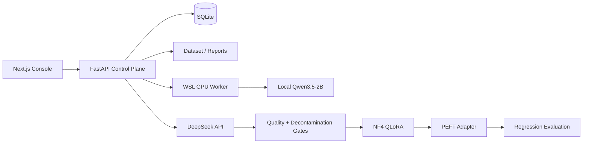

# EasyTune Eval Flywheel

[](https://www.python.org/)
[](https://fastapi.tiangolo.com/)
[](https://nextjs.org/)
[](LICENSE)

EasyTune Eval Flywheel 是一个面向大模型评测、Benchmark 与后训练数据飞轮场景的本地工程平台。项目将原有 LoRA 训练控制台扩展为一条可追溯、可复现的完整链路：

```text
数据上传
  → 去污染静态 Benchmark
  → 确定性 / 校准裁判
  → 动态变体鲁棒性评测
  → Clean Badcase 归因
  → 强模型定向数据合成
  → 质量门禁与反向去污染
  → NF4 QLoRA
  → Adapter 同口径回归
  → JSON / Markdown 实验报告
```

项目已在 **RTX 4060 Laptop GPU 8GB + Python 3.12 + 本地 Qwen3.5-2B** 环境中完成无 Mock 端到端验证。

## 核心能力

### 去污染基准评测

- 支持原始分数与去污染 Clean 分数并列输出；
- 使用 13-gram 精确重叠和字符相似度检测污染；
- 保存污染方法、匹配片段和逐题审计记录；
- 输出 Pass@1、Pass@k、Pass^k 和 Bootstrap 95% 置信区间；
- 输出数学、JSON 指令和 Python 代码等能力切片。

### 校准裁判

- 数值题使用确定性数值校验；
- JSON 任务使用合法性和字段约束检查；
- Python 任务执行固定单元测试；
- 主观任务可接 OpenAI-compatible LLM Judge；
- 保存 verdict、错误分类和失败原因。

### 动态变体与配对评测

- 支持实体替换和干扰约束注入；
- 保存原题与变体题的逐题对应关系；
- 输出 improved、regressed、unchanged-pass、unchanged-fail 配对转移；
- 用于区分原题得分与提示扰动下的鲁棒性。

### Badcase 数据飞轮

- 仅使用 Clean 且失败的样本进入归因；
- 区分 calculation、format、code 等错误类型；
- 使用 DeepSeek 官方 `deepseek-v4-pro` 生成定向训练样本；
- 对数学、JSON、代码采用分类专用生成提示；
- 使用数学复核、`json.loads`、Python AST 等质量门禁；
- 对生成题目与答案执行反向污染检查；
- 通过后转换为标准 Alpaca JSONL 并注册训练数据集。

### 真实 NF4 QLoRA

- 本地 Qwen3.5-2B 以 bitsandbytes NF4 4-bit 加载；
- 使用 LoRA rank 8、assistant-only loss 和 gradient checkpointing；
- 正式模式默认禁止静默回退到 Mock；
- 只有真实生成 `adapter_model.safetensors` 才创建 Ready ModelVersion；
- 回归前校验 TrainingJob、ModelVersion 和 FlywheelIteration 血缘。

### 严格回归与报告

- 基线和回归使用同一 Benchmark、污染参考集和 Clean 子集；
- 锁定模板、温度、token 上限、rollout、thinking 和量化参数；
- 分别比较原题与动态变体在训练前后的变化；
- 生成机器可读 JSON 和可阅读 Markdown 实验报告。

## 已验证实验

本次发布包含一个小规模工程验证：

- Benchmark：30 题；
- Clean 样本：28 题；
- 污染样本：2 题；
- 定向合成训练样本：6 条；
- QLoRA：1 epoch，6 optimizer steps；
- 训练峰值显存：约 3.69 GiB；
- Mock training：未使用。

| 评测模式 | Baseline Clean Pass@1 | QLoRA 后 Clean Pass@1 | Delta | Baseline 95% CI | Post 95% CI |
|---|---:|---:|---:|---|---|
| 原题 | 0.8929 | 0.9286 | +0.0357 | [0.7857, 1.0000] | [0.8214, 1.0000] |
| 动态变体 | 0.8214 | 0.8571 | +0.0357 | [0.6786, 0.9643] | [0.7500, 0.9643] |

> 这是 30 题、6 条训练样本、1 epoch 的端到端工程验证。置信区间存在明显重叠，因此项目只声明观察到小样本提升，不声明统计显著的通用能力提升。

完整脱敏证据：

- [实验说明](docs/experiments/qwen35-2b-flywheel/README.md)
- [四象限指标](docs/experiments/qwen35-2b-flywheel/metrics.json)
- [训练报告](docs/experiments/qwen35-2b-flywheel/training-report.json)

## 系统架构



Windows 上的 FastAPI 负责数据、任务、数据库和报告；WSL GPU Worker 负责本地模型推理、NF4 QLoRA 和 Adapter 加载；外部强模型仅用于正式数据合成与复核。

## 项目结构

```text
lora-eval-bench/
├─ easytune/
│  ├─ backend/
│  │  ├─ app/routers/       # Dataset、Benchmark、Flywheel、健康检查
│  │  ├─ app/services/      # 去污染、裁判、评测、训练、报告
│  │  ├─ app/workers/       # WSL Qwen GPU Worker
│  │  └─ tests/             # 核心回归测试
│  ├─ frontend/             # Next.js 管理控制台
│  └─ README.md             # 详细部署与复现说明
├─ docs/experiments/        # 脱敏实验结果
├─ eval_bench_30.json       # 30 题演示 Benchmark
├─ mock_train_with_leaks.json
└─ generate_experiment_data.py
```

## 快速开始

详细环境、WSL Worker、DeepSeek 配置、Swagger 流程和 API 清单见：

- [EasyTune 部署与复现指南](easytune/README.md)

运行组件：

```text
Frontend:   http://127.0.0.1:3000
Backend:    http://127.0.0.1:8000
Swagger:    http://127.0.0.1:8000/docs
GPU Worker: http://127.0.0.1:8011
```

静态 Benchmark 核心请求：

```json
{
  "name": "Qwen3.5-2B-Static-Baseline",
  "base_model": "<LOCAL_QWEN_MODEL_PATH>",
  "benchmark_dataset_id": 1,
  "reference_train_dataset_id": 2,
  "decontamination_enabled": true,
  "use_dynamic_perturbation": false,
  "judge_mode": "hybrid",
  "template": "qwen3_5_nothink",
  "temperature": 0.0,
  "max_new_tokens": 512,
  "num_rollouts": 1,
  "enable_thinking": false,
  "load_in_4bit": true
}
```

## 测试

后端：

```powershell
.\easytune\backend\.venv\Scripts\python.exe `
  -m unittest discover -s easytune/backend/tests -v
```

前端：

```powershell
cd easytune/frontend
pnpm install --frozen-lockfile
pnpm build
```

## 安全与发布边界

仓库不会提交：

- DeepSeek API Key 或 `.env`；
- 本地 Qwen 模型权重；
- QLoRA Adapter 权重；
- SQLite 数据库；
- 上传后的数据副本、日志和运行缓存；
- `node_modules`、`.next` 和 Python 虚拟环境。

公开实验包只包含脱敏指标和复现说明。

## Roadmap

- 交互式、多轮 Tool-use Benchmark；
- 更大规模独立 holdout 与多随机种子评测；
- Judge 一致性和人工标注校准；
- 数值变化与答案同步重算的动态变体；
- 异步任务队列与断点恢复；
- 可导出的图表和对比实验页面。

## License

[Apache License 2.0](LICENSE)
